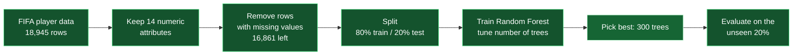
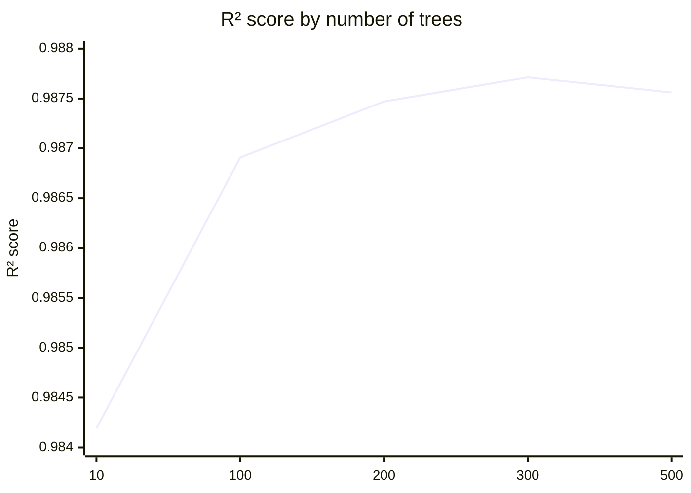
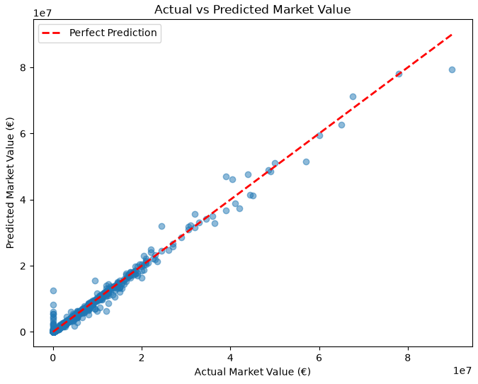
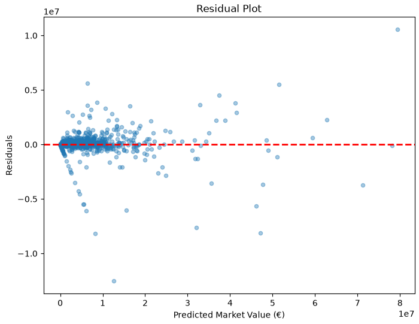
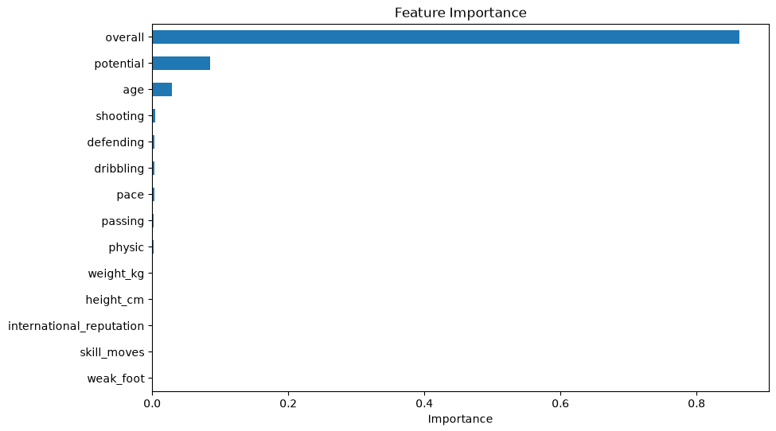

<p align="center">
  
</p>

<p align="center">
  
</p>

<p align="center">
  
  
  
</p>

<p align="center">
  
  
  
  
  
</p>

<p align="center">
  <a href="#-the-transfer-market-question">The Question</a> •
  <a href="#-dataset">Dataset</a> •
  <a href="#-the-scouting-process">Process</a> •
  <a href="#-how-many-scouts">How Many Scouts</a> •
  <a href="#-results">Results</a> •
  <a href="#-what-drives-a-players-price">Price Drivers</a> •
  <a href="#-installation">Install</a>
</p>

---

##  The Transfer Market Question

> [!NOTE]
> **In one sentence:** this project teaches a Random Forest to look at a FIFA player's attributes (rating, potential, pace, shooting and more) and predict his **market value in euros**, explaining about **98.8%** of why players' prices differ.

**Explain it like I'm five:**
Imagine a club has to price a player. It asks **300 scouts**. Each scout looks at the player a little differently and writes down a price. The club takes the **average of all 300 guesses**. That is exactly how a Random Forest works: every "scout" is a decision tree, and the final price is their combined vote.

```
 Player attributes  ➜   300 scouts (trees) each guess a price  ➜   Average of all guesses  ➜   Market value
```

---

##  Dataset

**Source:** [Football Price Prediction on Kaggle](https://www.kaggle.com/datasets/thedevastator/footballpriceprediction)

| Property | Value |
|---|---:|
| Original rows | 18,945 |
| Rows after cleaning | 16,861 |
| Selected features | 14 |
| Target variable | `value_eur` |

```
Players kept after cleaning   █████████████████░░░  ~89%   (16,861 of 18,945)
```

<details open>
<summary><b> The 14 attributes the model reads</b></summary>

<br/>

| Feature | What it tells the scouts |
|---|---|
| `age` | How old the player is |
| `overall` | Current overall rating |
| `potential` | Projected ceiling rating |
| `height_cm` | Height in centimeters |
| `weight_kg` | Weight in kilograms |
| `weak_foot` | Weak-foot skill rating |
| `skill_moves` | Skill move rating |
| `international_reputation` | International reputation rating |
| `pace` | Pace attribute |
| `shooting` | Shooting attribute |
| `passing` | Passing attribute |
| `dribbling` | Dribbling attribute |
| `defending` | Defending attribute |
| `physic` | Physical attribute |

</details>

**Target:** `value_eur`, the player's market value in euros.

---

##  The Scouting Process



- 🎯 **Feature selection:** isolated the 14 relevant numeric attributes and dropped non-predictive or non-numeric columns.
- 🧹 **Cleaning:** removed rows with missing values, going from **18,945 to 16,861** rows. Roughly 11% was lost and the large majority kept.
- ✂️ **Train/test split:** **80% training, 20% testing.** Think of it as practicing drills in training (80%) and then playing a real match (20%) the team has never seen.

### 🌲 Why Random Forest?

Player value is not a straight line. A high `overall` rating *plus* high `potential` *plus* youth compounds into something much bigger than each part alone, and a simple linear model struggles with that. Random Forest:

- ✅ Captures non-linear relationships and interactions on its own
- ✅ Handles outliers well and needs no feature scaling
- ✅ Shows which features mattered most (great for explanations)

---

## 📈 How Many Scouts?

More scouts usually help, but only up to a point. Five forest sizes were tested:

| Trees | R² Score | MAE (€) | RMSE (€) | |
|---:|---:|---:|---:|:-:|
| 10 | 0.984191 | 150,649.42 | 669,794.14 | |
| 100 | 0.986909 | 136,935.41 | 609,523.61 | |
| 200 | 0.987470 | 135,557.55 | 596,301.57 | |
| **300** | **0.987713** | **134,716.99** | **590,496.91** | 🏆 |
| 500 | 0.987561 | 134,317.84 | 594,148.20 | 📉 |



> [!IMPORTANT]
> **The sweet spot is 300 trees.** Accuracy climbs steadily until 300, then flattens. At 500 trees the R² is actually a touch *lower* on this test split while costing more compute. It is like hiring scout number 301: the average barely moves, but the payroll keeps growing.

**Final model:** Random Forest Regressor · `n_estimators = 300` · `random_state = 42`

---

## 📊 Results

<div align="center">

### 🎯 R² Score: **0.9877**

</div>

| Metric | Formula | Value | In plain words |
|---|---|---:|---|
| **R² Score** | 1 − (SS_res / SS_tot) | **0.9877** | Explains about 98.8% of why player values differ |
| **MAE** | (1/n)·Σ\|yᵢ − ŷᵢ\| | **€134,716.99** | A typical prediction is off by roughly €135K |
| **RMSE** | √[(1/n)·Σ(yᵢ − ŷᵢ)²] | **€590,496.91** | Same idea, but big misses are punished harder |

> [!TIP]
> **Why is RMSE so much bigger than MAE?** A few large misses pull RMSE up. Those are most likely **superstar players**, whose prices depend on things this dataset can't see, such as brand value and marketability.

### 🔍 Visual check-ups

**Actual vs. Predicted:** if every guess were perfect, all dots would sit on the diagonal line. They hug it tightly, which confirms the high R² across the value range.

<p align="center">
  
</p>

**Residuals (the mistakes):** they scatter randomly around zero with no strong pattern. That means the model isn't consistently over- or under-pricing any particular group of players.

<p align="center">
  
</p>

---

## 🥇 What Drives a Player's Price?

The feature importance chart shows which attributes the scouts leaned on most:

| Rank | Driver | The story |
|:-:|---|---|
| 🥇 | **`overall`** | The dominant predictor by a wide margin: the best single summary of current ability |
| 🥈 | **`potential`** | The market pays for the *future*: young players with a high ceiling cost more |
| 🎽 | **Technical skills** | Shooting, passing, dribbling and defending matter, but each has a much smaller impact |

<p align="center">
  
</p>

---

## 🧰 Technologies Used

| Category | Tools |
|---|---|
| Language | 🐍 Python |
| Data Handling | Pandas, NumPy |
| Visualization | Matplotlib |
| Machine Learning | Scikit-learn (Random Forest Regressor) |
| Environment | Jupyter Notebook |

---

## 📁 Project Structure

```
Football-Player-Market-Value-Prediction/
│
├── Images/
│   ├── actual_vs_predicted.png
│   ├── feature_importance.png
│   └── residual_plot.png
├── data/
│   └── fifa_players.csv
├── notebooks/
│   └── market_value_prediction.ipynb
├── README.md
└── requirements.txt
```

---

## ⚙️ Installation

```bash
# 1. Clone the repository
git clone https://github.com/khaled-amireh/Football-Player-Market-Value-Prediction.git
cd Football-Player-Market-Value-Prediction

# 2. Create and activate a virtual environment (recommended)
python -m venv venv
source venv/bin/activate      # On Windows: venv\Scripts\activate

# 3. Install dependencies
pip install -r requirements.txt

# 4. Launch the notebook
jupyter notebook notebooks/market_value_prediction.ipynb
```

---

## ⚠️ Limitations

<details>
<summary><b>Click to see what this model does not do (yet)</b></summary>

<br/>

- Evaluated on a single train/test split, not cross-validated, so metrics may vary a little on a different split.
- Elite and superstar valuations depend on factors outside this dataset (brand value, marketability, contract situation), which likely explains the larger residuals for high-value players.
- Only numeric FIFA attributes were used. Club, league, nationality and position were not included and could add signal.

</details>

---

## ✅ Conclusion

Random Forest Regression delivered excellent results, with an **R² of 0.9877**, explaining nearly 99% of the variance in player market value. Ratings, especially **`overall`** and **`potential`**, are the main drivers of price. Tuning showed that **300 trees** is the best balance of accuracy and compute for this dataset, with diminishing (and occasionally negative) returns beyond it.

---

## 🚀 Future Improvements

- [ ] K-Fold Cross-Validation for a sturdier performance estimate
- [ ] Add categorical features (position, league, nationality) via encoding
- [ ] Tune more than `n_estimators` (`max_depth`, `min_samples_split`)
- [ ] Benchmark against XGBoost / LightGBM
- [ ] SHAP analysis to explain each individual player's price

---

## 👤 Author

<p align="center">
  <b>Khaled Amireh</b><br/>
  <a href="https://github.com/khaled-amireh">🔗 GitHub</a>
</p>

<p align="center"><i>If this project helped you, drop a ⭐ on the repo.</i></p>

<p align="center">
  
</p>
