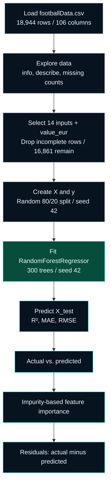

<p align="center">
  
</p>

<h1 align="center">FOOTBALL PLAYER VALUE PREDICTION</h1>

<p align="center">
  <strong>Predicting Player Market Value Through Machine Learning</strong><br>
  A Random Forest regression case study estimating FIFA-reported player valuations in euros<br>
  from ability, potential, age, and physical and technical attributes.
</p>

<p align="center">
  
  
  
  
  
  
</p>

**18,944 players loaded · 16,861 complete records · 14 input features**

| Saved metric | Result |
|---|---:|
| **R²** | **0.987713** |
| **MAE** | **€134,716.99** |
| **RMSE** | **€590,496.91** |

> **Evidence scope:** these figures are supported by the code and saved outputs in [the notebook](Football_Player_Value_Prediction.ipynb). Metrics describe the 300-tree model on a single random 80/20 split. Training was not rerun for this documentation update; these are dataset valuations, not observed transfer fees.

### Quick Navigation

[Overview](#01-executive-overview) · [Dataset](#03-dataset-intelligence) · [Workflow](#04-machine-learning-architecture) · [Features](#06-feature-intelligence) · [Model](#07-random-forest-regressor) · [Comparison](#08-model-comparison)<br>
[Results](#09-results-and-evaluation) · [Diagnostics](#10-visual-model-diagnostics) · [Importance](#11-understanding-player-value) · [Repository](#12-repository-structure) · [Reproduce](#13-installation-and-reproduction) · [Limitations](#14-reliability-and-limitations)

---

## 01 Executive Overview

This project learns a mapping from 14 numeric FIFA player attributes to `value_eur` using scikit-learn's `RandomForestRegressor`. The notebook inspects the data, selects columns, removes incomplete records, trains a 300-tree forest, and evaluates predictions with R², MAE, and RMSE. Three plots examine prediction agreement, feature importance, and residuals.

The saved R² of **0.987713** indicates a close fit to the held-out dataset valuations. The engineering question that remains is how well that fit transfers to other samples, seasons, and valuation sources. The repository contains an exploratory notebook, without a serialized model or deployment interface.

## 02 The Football Valuation Problem

Player valuation is a regression task: the output is a continuous euro amount. Relationships can be nonlinear; for example, the association between overall rating and value may depend on potential and age. Trees can partition this feature space and represent interactions without specifying a linear equation.

The implemented inputs describe in-game ability, projected potential, physique, technical skills, reputation, and age. They exclude club, league, nationality, and position, even though some of those columns exist in the source. Contract terms, injury history, bargaining conditions, and commercial appeal are not modeled. The notebook does not test their contribution or establish an economic pricing mechanism.

**Prediction scope:** estimate the dataset's reported valuation for a player with complete selected attributes. A prediction is neither a guaranteed transfer price nor a forecast of a future transaction.

## 03 Dataset Intelligence

**Repository-cited source:** [Potential Stars: Predicting Football Player Prices — The Devastator, Kaggle](https://www.kaggle.com/datasets/thedevastator/footballpriceprediction).

| Property | Evidence-backed description |
|---|---|
| Input filename | `footballData.csv`, read from the notebook's working directory |
| Loaded data | **18,944 rows × 106 columns**, shown by `df.info()` |
| Modeling data | **16,861 rows × 15 columns**: 14 inputs and the target |
| Removed records | **2,083**, or approximately **11.00%** of loaded rows |
| Target | `value_eur`, retained in euros without transformation |
| Missing selected fields | Each of `pace`, `shooting`, `passing`, `dribbling`, `defending`, and `physic` has 2,083 missing entries before cleaning |
| Storage | The CSV is absent from the tracked repository and this checkout |

Both `df.info()` and `df.describe()` support the **18,944** input-record count. The full input includes many other missing fields, but cleaning applies only to the selected 15 columns.

See the [dataset provenance guide](docs/DATA.md) for the required columns, source-recovery options, and commands to record a local checksum without changing the input.

**Provenance boundary:** the notebook records the local filename, not a download URL, dataset version, checksum, or explicit FIFA edition. Direct checks of the cited Kaggle page and API returned **HTTP 404 in this environment** during this update, despite a cached listing entry. Current download access, file metadata, data-use terms, and the exact archive filename remain unverified. Faithful reproduction requires the original CSV from a working source; do not assume the repository's MIT license licenses the dataset.

## 04 Machine Learning Architecture

The diagram follows the notebook's execution sequence. It contains one saved model fit, without a tuning or deployment stage.



## 05 Data Preparation

1. **Inspect:** `df.info()`, `df.describe()`, and sorted missing-value counts describe the full loaded table.
2. **Select:** a manually specified `features` list retains the 14 columns below alongside `value_eur`.
3. **Clean:** `df.dropna()` removes records missing any selected input or the target. There is no imputation. The remaining row count is printed as 16,861.
4. **Separate:** `X = df[features]` and `y = df['value_eur']` keep the target outside the predictors. There is no scaling, encoding, log transformation, or target clipping.
5. **Split:** `train_test_split(X, y, test_size=0.2, random_state=42)` creates a shuffled random split. The implied sizes are **13,488 training** and **3,373 test** records, derived from the retained count and split fraction rather than printed outputs.

Column selection and complete-case filtering occur **before** the split. No preprocessing statistics are learned, and these operations are not wrapped in an sklearn `Pipeline`. There is **no correlation matrix, correlation threshold, or automated feature-selection procedure** in the notebook; the feature list is a manual choice.

## 06 Feature Intelligence

The following table preserves the exact input names and their order in the notebook.

| # | Feature | Group | Meaning |
|---:|---|---|---|
| 1 | `age` | Demographics | Player age |
| 2 | `overall` | Player ability | Overall FIFA rating |
| 3 | `potential` | Potential | Projected potential rating |
| 4 | `height_cm` | Physical attributes | Height in centimeters |
| 5 | `weight_kg` | Physical attributes | Weight in kilograms |
| 6 | `weak_foot` | Technical skills | Weak-foot rating |
| 7 | `skill_moves` | Technical skills | Skill-move rating |
| 8 | `international_reputation` | Reputation | International reputation rating |
| 9 | `pace` | Physical attributes | Pace rating |
| 10 | `shooting` | Technical skills | Shooting rating |
| 11 | `passing` | Technical skills | Passing rating |
| 12 | `dribbling` | Technical skills | Dribbling rating |
| 13 | `defending` | Technical skills | Defending rating |
| 14 | `physic` | Physical attributes | Physicality rating |

`value_eur`, `wage_eur`, and `release_clause_eur` are **not inputs**. Excluding monetary predictors reduces one obvious route for target-proxy leakage; the provenance of the retained ratings still warrants review.

## 07 Random Forest Regressor

The training cell contains:

```python
regressor = RandomForestRegressor(n_estimators=300, random_state=42)
regressor.fit(X_train, y_train)
```

| Setting | Value in the saved estimator display |
|---|---|
| Number of trees | `n_estimators=300` |
| Random seed | `random_state=42` |
| Split criterion | `criterion='squared_error'` |
| Tree depth | `max_depth=None` |
| Minimum split / leaf samples | `min_samples_split=2` / `min_samples_leaf=1` |
| Candidate features per split | `max_features=1.0` |
| Bootstrap / out-of-bag evaluation | `bootstrap=True` / `oob_score=False` |

Only the tree count and seed are explicitly supplied; the other settings are recorded defaults. The forest averages regression-tree predictions built from bootstrap samples. Threshold splits capture nonlinear relationships and interactions, while averaging can reduce variance relative to an individual tree. Numeric inputs need no feature scaling for this estimator. These properties motivate the choice; no baseline comparison establishes superiority in this repository. See the [scikit-learn estimator reference](https://scikit-learn.org/stable/modules/generated/sklearn.ensemble.RandomForestRegressor.html).

## 08 Model Comparison

**One configuration is verifiable from the tracked notebook.** It contains a single 300-tree instantiation, fit, and evaluation. No experiment loop, search object, cross-validation results, or alternate model outputs are preserved.

| Tree count | Evidence available | Interpretation |
|---|---|---|
| 300 | Training code, saved estimator, and saved metrics | Documented configuration |
| 10, 100, 200, 500 | Mentioned only in the previous README | Experiments and metrics cannot be independently verified |

The earlier comparison reported higher R² and lower RMSE for 300 trees, but slightly lower MAE for 500 trees. That would be a metric trade-off, not a win on every measure. Because those alternate runs are absent, their numbers are not carried forward as validated results. The evidence supports neither an optimal tree count nor a measured compute/performance advantage.

**Selection-bias risk:** the notebook does not establish how 300 trees was chosen. If the earlier comparison used this same test split to choose the model, that split influenced selection and is no longer an independent final assessment. Repeated test-set use is unverified, rather than a demonstrated defect. Future comparisons should use a validation split or cross-validation within the training data, followed by one untouched test evaluation, consistent with [scikit-learn's evaluation guidance](https://scikit-learn.org/stable/common_pitfalls.html#data-leakage).

## 09 Results and Evaluation

**Evaluation conditions:** 300 trees; split and model seeds both 42; predictions on the held-out 20% of complete-case records; target and errors measured in euros.

| Metric | Saved result, rounded | What it measures |
|---|---:|---|
| **R²** | **0.987713** | `1 − SSE/SST`: fit relative to the variance of test target values |
| **MAE** | **€134,716.99** | Mean absolute prediction error across test records |
| **RMSE** | **€590,496.91** | Square root of mean squared error; gives greater weight to large errors |

R² corresponds to about **98.77% of test-target variance explained** on this split, not 98.77% prediction accuracy or an explanation of real-world price formation. MAE is an average absolute error, not a median, error bound, or guarantee for an individual player.

RMSE is approximately **4.38 times MAE**, showing that larger errors weigh heavily in the aggregate result. The notebook does not report error by valuation band, relative percentage error, confidence intervals, or repeated-split variability. The saved aggregate metrics cannot establish uniform performance across player groups.

<details>
<summary><strong>Audit trail: exact saved outputs</strong></summary>

In [Football_Player_Value_Prediction.ipynb](Football_Player_Value_Prediction.ipynb), counting all cells from 1: cell 7 records the loaded shape; cell 11 selects and cleans the data; cell 12 prints the retained count; cell 14 splits the data; cell 16 fits the forest; cell 20 prints:

```text
R2 Score : 0.9877130651871356
MAE: 134716.98784464868
RMSE: 590496.9112839565
```

Cells 22, 24, and 26 generate the prediction, importance, and residual plots respectively. This is an audit of saved evidence, not a fresh execution.

</details>

## 10 Visual Model Diagnostics

The figures below are the existing tracked assets. They are reused without altering the charts or generating new evaluation data.

### Actual vs. predicted

<p align="center">
  
</p>

The points broadly follow the perfect-prediction diagonal. Visible departures include predictions both above and below it, including at high valuations. Concentration near the lower end of the axis makes aggregate visual agreement insufficient to assess every value range.

### Residual analysis

<p align="center">
  
</p>

Residuals are defined as **actual − predicted**: positive values indicate underprediction; negative values indicate overprediction. The chart includes substantial errors on both sides of zero. It does not establish random residuals, constant error variance, or absence of subgroup bias; no formal residual or subgroup tests are recorded.

## 11 Understanding Player Value

<p align="center">
  
</p>

| Observed rank | Feature | Supported interpretation |
|---:|---|---|
| 1 | `overall` | Dominates the forest's impurity-reduction importance |
| 2 | `potential` | Second-largest importance score |
| 3 | `age` | Third-largest importance score |
| Remaining | Other 11 inputs | Much smaller scores in the existing chart |

The notebook sorts `regressor.feature_importances_` and draws a horizontal bar chart. It does not print a complete numeric importance table, so exact percentages are not inferred from bar lengths.

These are **predictive importance scores within this fitted forest**, not causal effects or the direction of a feature's association with value. Impurity-based importance can favor features with many possible split values; correlated inputs can also complicate attribution. Low importance does not establish irrelevance. Permutation importance and SHAP analysis remain future work; see the [scikit-learn importance example](https://scikit-learn.org/stable/auto_examples/ensemble/plot_forest_importances.html) for method limitations.

## 12 Repository Structure

Core project files (editor and Git attributes/ignore configuration omitted):

```text
Football-Player-Value-Prediction/
├── .github/
│   └── workflows/
│       └── checks.yml
├── Football_Player_Value_Prediction.ipynb
├── docs/
│   ├── DATA.md
│   └── TROUBLESHOOTING.md
├── Images/
│   ├── actual_vs_predicted.png
│   ├── feature_importance.png
│   ├── football-intelligence-banner.svg
│   └── residual_plot.png
├── LICENSE
├── README.md
├── requirements.txt
├── tests/
│   ├── test_notebook.py
│   └── test_repository.py
└── tools/
    └── check_repository.py
```

**Required local input:** place `footballData.csv` beside the root notebook. It is not a tracked project file. The repository has no `data/`, `notebooks/`, `src/`, saved model, or deployment files.

## 13 Installation and Reproduction

**1. Clone the repository.**

```bash
git clone https://github.com/khaled-amireh/Football-Player-Value-Prediction.git
cd Football-Player-Value-Prediction
python -m venv .venv
```

**2. Activate the environment.** Choose the command for your shell.

Windows PowerShell:

```powershell
.\.venv\Scripts\Activate.ps1
```

Windows Command Prompt:

```bat
.venv\Scripts\activate.bat
```

macOS / Linux:

```bash
source .venv/bin/activate
```

**3. Install the declared dependencies.**

```bash
python -m pip install -r requirements.txt
```

**4. Obtain the original dataset.** Check the [repository-cited Kaggle listing](https://www.kaggle.com/datasets/thedevastator/footballpriceprediction). Direct verification returned HTTP 404 from this environment; dataset access must be restored or an original copy obtained before training can be reproduced. If the listing is accessible to you, download and extract its CSV, signing in if required. Place the original input at `Football-Player-Value-Prediction/footballData.csv`. If the archive uses a different filename, confirm the required columns and rename a local copy to `footballData.csv`. The notebook reads that exact relative filename. Compare the loaded shape with **18,944 × 106**; a matching shape alone does not prove identical data. A similar FIFA dataset is not a verified substitute for reproducing these saved metrics.

**5. Open the root notebook.** Run this from the repository directory, select the environment's Python kernel, and execute cells in order.

```bash
python -m notebook Football_Player_Value_Prediction.ipynb
```

If imports fail, the CSV cannot be found, or PowerShell blocks activation, use the [setup troubleshooting guide](docs/TROUBLESHOOTING.md). It includes interpreter checks, named-kernel registration, and commands that use the virtual environment directly.

**Reproducibility status:** notebook metadata records **Python 3.11.9**. `requirements.txt` lists Pandas, NumPy, Matplotlib, scikit-learn, and Jupyter without version pins. The original environment is not fully captured, and the CSV version is not recorded. Fixed seeds help repeat the split and fitting, but do not guarantee identical results across data and dependency changes. Installation and a clean training run were not performed for this documentation update.

**Run the small regression tests** after installing requirements:

```bash
python -m unittest discover -s tests -v
```

These tests exercise individual notebook cells with tiny synthetic inputs. They do not load the original player CSV, train the forest, or refresh the historical notebook outputs. The cleaning diagnostic now prints its missing-value counts as well as the row count on the next execution.

**Check documentation and recorded evidence offline:**

```bash
python tools/check_repository.py
```

This standard-library-only command checks local Markdown/image paths and anchors, notebook Python syntax, and whether the README's feature names and reported metrics agree with the notebook. It returns a nonzero exit code with file-specific messages on failure. It does not check external website availability or execute notebook cells. The unit tests also cover broken references and stale evidence using temporary fixtures.

The [Repository checks workflow](.github/workflows/checks.yml) runs these checks and tests on Ubuntu and Windows with Python 3.11 for pushes and pull requests. It installs the declared dependencies but does not download the dataset or train a model. These checks validate repository consistency, not the historical ML performance.

## 14 Reliability and Limitations

| Area | What the repository establishes | Remaining limitation |
|---|---|---|
| Evaluation design | One shuffled 80/20 split with seed 42 | No cross-validation, repeated seeds, temporal split, or external validation |
| Model selection | One saved 300-tree configuration | Earlier comparison history is absent; test-set reuse could bias selection |
| Missing data | Complete-case deletion removes 2,083 records | Missingness may change the represented player population; position-level exclusions are not audited |
| Target leakage | The target is separate from `X`; wages and release clauses are excluded | FIFA ratings and valuations may share an underlying construction process; no source-formula or duplicate-player audit establishes independence |
| Error distribution | Aggregate metrics and two prediction diagnostics | Large residuals are visible; value-band errors and subgroup fairness are unmeasured |
| Generalization | Evaluation within the available dataset | Exact snapshot period is undocumented; other seasons and live-market valuations are untested |
| Reproduction | Saved outputs, seeds, and dependency names | CSV absent; cited source returned HTTP 404 during checks; no data checksum, dependency lock, or fresh run verified |
| Interpretation | Impurity-based importance | No causal inference, local explanations, or uncertainty estimates |

High R² alone neither diagnoses leakage nor rules it out. Same-source ratings can legitimately predict a dataset's valuation rules while offering limited evidence about independent transfer-market outcomes. These are risks to investigate, not confirmed leakage findings.

## 15 Future Roadmap

Every item below is **unimplemented future work**.

- [ ] Reserve an untouched final test set and use a separate validation split or K-fold cross-validation for model selection.
- [ ] Compare a dummy baseline, linear regression, gradient boosting, and XGBoost under the same evaluation protocol.
- [ ] Record a reproducible hyperparameter search, including depth, leaf size, feature sampling, and tree count.
- [ ] Audit duplicates, data provenance, rating/valuation construction, and performance on a later season or external source.
- [ ] Analyze absolute and relative errors by valuation range, age, and position; quantify uncertainty.
- [ ] Audit missingness by position and compare complete-case deletion with training-only imputation in a pipeline.
- [ ] Add permutation importance and SHAP explanations with correlated-feature caveats.
- [ ] Pin dependencies, record the dataset version and checksum, and verify a clean notebook execution.
- [ ] Serialize a validated model and optionally build an interactive player-value estimator with clear prediction limits.

## 16 Author and License

**Khaled Amireh** · [GitHub](https://github.com/khaled-amireh) · [Portfolio](https://portfolio-1kpn.onrender.com)

Released under the [MIT License](LICENSE), copyright © 2026 Khaled Amireh. Dataset access and reuse remain subject to the source's own terms.
